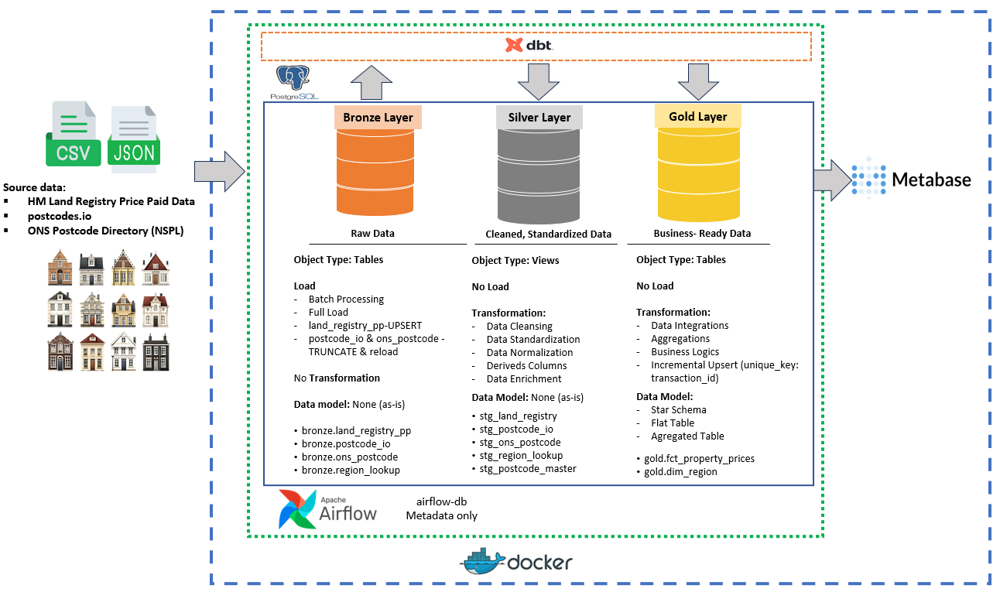

# UK Property Data Pipeline (Estate)


A zero-cost, on-premise, end-to-end data engineering pipeline for UK residential property price data — built to demonstrate medallion architecture, orchestration, transformation-as-code, data quality handling, and BI serving using a fully open-source stack.

---

## Project Overview

This project ingests UK property transaction data and postcode reference data from public, free sources, models it through a bronze → silver → gold medallion architecture using dbt, and serves the result through a self-hosted BI tool (Metabase). Everything runs locally via Docker Compose — there is no cloud dependency and no recurring cost.

The pipeline demonstrates a realistic, small-scale version of a production data platform: scheduled ingestion, a raw/unmodified bronze layer, typed and cleaned silver models, a reconciled dimension built from two overlapping geographic sources, explicit handling of source-data quality issues, and an analytics layer a non-technical stakeholder could query through dashboards.

## Dataset Description

Three public UK datasets are combined:

|    Dataset   |    Publisher    |    Update frequency    |    Access    |
|--------------|------------------|-----------|---------------------------|
| Price Paid Data (PPD) | HM Land Registry | Monthly update file (published on the 20th working day) | Free bulk CSV, no auth |
| Postcode lookup | postcodes.io | Live API | Free bulk lookup API, no key |
| Postcode directory (NSPL) | Office for National Statistics (ONS) | Periodic (~quarterly) | Free bulk CSV (zip), no key |

Price Paid Data provides the transactional record (what sold, for how much, when, and its postcode). The two postcode sources provide geographic enrichment (region, local authority, latitude/longitude) and are deliberately overlapping: ONS NSPL is treated as the authoritative government reference and takes precedence, with postcodes.io used as a fallback for any postcode ONS doesn't resolve.

**Note on the Land Registry source file:** `pp-monthly-update-new-version.csv` is the monthly update file. It contains the current month's transactions plus updates to earlier releases, so transaction dates can span many years in a single download. This is expected, not a bug. Price Paid Data covers England and Wales only; the postcode reference data covers the whole UK.

## Business Questions Addressed

This pipeline is designed to answer real property-market questions, not just move data. Each question maps to a section of the [dashboard](dashboard.md):

| # | Business question | Dashboard section |
|---|---|---|
| 1 | How have property prices moved month over month, by region? | 2.1 Monthly price trends |
| 2 | Which postcode districts have shown the strongest historical price appreciation? | 2.2 Top 10 districts by CAGR |
| 3 | How do prices, transaction activity, and housing mix differ across regions? | 3.1 to 3.3 Market Segmentation |
| 4 | Can the data be trusted? (freshness, geographic match rate, flagged outliers) | 1. Overview and Data Quality |

## Data Dictionary

**`bronze.land_registry_pp`** — one row per property transaction, loaded as-is from the source file (no filtering applied at ingestion time)

| Column | Type | Description |
|---|---|---|
| transaction_id | text (primary key)  | Unique ID for the transaction |
| price | numeric | Sale price, GBP, as recorded by HM Land Registry |
| date_of_transfer | date | Date the transfer was completed |
| postcode | text | Property postcode |
| property_type | char(1) | D=Detached, S=Semi-detached, T=Terraced, F=Flat/Maisonette, O=Other |
| old_new | char(1) | Y=Newly built, N=Established |
| duration | char(1) | F=Freehold, L=Leasehold |
| paon / saon | text | Primary/secondary addressable object name (house number/unit) |
| street, locality, town_city, district, county | text | Address components |
| ppd_category_type | char(1) | A=Standard entry, B=Additional entry (portfolio/bulk/non-market transactions — often extreme outlier prices) |
| record_status | char(1) | A=Addition, C=Change, D=Delete. All rows loaded by the historical backfill are marked A, since the backfill is a snapshot and carries no change history. |

**`bronze.postcode_io`** — one row per postcode, from postcodes.io

| Column | Type | Description |
|---|---|---|
| postcode | text | Postcode |
| latitude / longitude | double | Coordinates |
| region, admin_district | text | Administrative geography (human-readable names) |

**`bronze.ons_postcode`** — one row per postcode, from the ONS NSPL (combined UK file, ~2.7M rows including historical/terminated postcodes)

| Column | Type | Description |
|---|---|---|
| postcode | text | Postcode |
| status | text | Termination date (YYYYMM); null = still live |
| latitude / longitude | double | Coordinates |
| region_code, lad_code | text | Administrative geography, as **codes only** (e.g. `E12000007`) — NSPL never provides human-readable names |
| lsoa_code, msoa_code | text | Statistical output area codes |

**`bronze.region_lookup`** — ONS region code → human-readable name mapping, extracted from the same NSPL zip's `Documents/` folder (since NSPL's main file only ever provides codes)

**`gold.fct_property_prices`** — grain: one row per transaction

| Column | Description |
|---|---|
| transaction_id | Unique transaction identifier |
| price, transaction_date, transaction_month | Sale facts |
| is_price_outlier | `true` if `price > 10,000,000` — flags likely data-entry errors or non-market bulk transactions in the source, without silently dropping the row |
| property_type, ppd_category_type, postcode | Transaction attributes |
| region, admin_district, latitude, longitude | Enriched from the reconciled postcode model, with `region` translated to a readable name via `region_lookup` |
| postcode_source | Which source resolved the postcode: `ons` or `postcodes_io` |

**`gold.dim_region`** — distinct regions/admin districts for dashboard filters.

## Pipeline Architecture



- **Sources**: HM Land Registry Price Paid Data (CSV), postcodes.io (REST API/JSON), ONS Postcode Directory/NSPL (CSV in zip)
- **Orchestration**: Apache Airflow schedules and coordinates ingestion and transformation tasks. Task failures, after retries are exhausted, post to a Discord webhook. `max_active_runs=1` prevents overlapping runs.
- **Extract & Load**: raw data lands **as-is** in the bronze schema of a single PostgreSQL instance — no cleaning, no type casting, no filtering at ingestion time. 
  - `postcode_io` and `ons_postcode` (reference/dimension data, not time-series) use **truncate-and-reload** per run, where reference tables are replaced in a single transaction, and input NSPL data is validated before touching existing data.
  - `land_registry_pp` (transactional fact data) uses **UPSERT on `transaction_id`** (v1.0+), since the monthly update file is not a cumulative history — truncate-and-reload would cause historical data to be silently discarded between runs (see Version History).
- **Transform**: dbt-core reads from bronze and builds:
  - **silver** — cleaned, typed staging models (`stg_land_registry`, `stg_postcode_io`, `stg_ons_postcode`, `stg_region_lookup`, `stg_postcode_master`) — this is the *only* layer where nulls are filtered and types are cast
  - **gold** — analytics-ready marts (`gold.fct_property_prices`, `gold.dim_region`)
- **Single warehouse**: bronze, silver, and gold are schemas within the *same* Postgres instance — not separate databases. A custom `generate_schema_name` dbt macro ensures models land in exactly `silver`/`gold`, not dbt's default `bronze_silver`/`bronze_gold` naming
- **Metadata isolation**: Airflow's own scheduling/run history lives in a separate `airflow-db` instance, isolated from the data warehouse
- **Serving**: Metabase connects to the gold schema for BI dashboards and reporting. Metabase's own app data (dashboards, questions, users) persists in a named Docker volume, so it survives container restarts without re-running the setup wizard each time
- **Infrastructure**: every component — Airflow, Postgres, dbt, Metabase — runs as a containerized service in a single Docker Compose stack. The Airflow container runs as the host user's UID (via `AIRFLOW_UID`) so it can write into bind-mounted project folders without permission conflicts

## Modern Data Stack

| Layer | Tool | Notes |
|---|---|---|
| Orchestration | Apache Airflow 2.9.3 (Docker, LocalExecutor) | DAG-based dependency management |
| Containerization | Docker Compose, custom Airflow image (`Dockerfile.airflow`) | `PYTHONPATH` set at the container level so ingestion modules import cleanly, no `sys.path` hacks in DAG code |
| Storage / warehouse | PostgreSQL 16 | Schema-based medallion separation (bronze/silver/gold) |
| Transformation | dbt-core 1.8.2 + dbt-postgres 1.8.2 | `fct_property_prices` uses incremental materialization with `unique_key='transaction_id'` (v1.0+) |
| BI / serving | Metabase, pinned to `v0.58.34` (LTS, security support through Feb 2027) | Chosen deliberately after checking metabase.com/version-support — not `latest`, for reproducibility |
| Python deps | pandas 2.1.4, SQLAlchemy 1.4.51 (both pinned together: pandas ≥2.2 requires SQLAlchemy ≥2.0, which conflicts with Apache Airflow 2.9.3's SQLAlchemy <2.0 requirement) | |
| CI | GitHub Actions | Lint, compose validation, `dbt parse`, and Airflow image build/import smoke tests on every push and pull request |
  | Data quality | dbt tests + `dbt_utils` | Generic tests on key columns plus singular tests for match rate, row-count floor, region naming, and freshness. Tests run after `dbt_run`, so a failure raises an alert but does not roll back the update |

## Dashboards


For complete information regarding metrics, queries, and visualizations, see the [Dashboard Documentation](dashboard.md).


## Project Folder Structure

```
uk-estate-pipeline/
├── .env.example
├── .gitignore
├── Dockerfile.airflow
├── README.md
├── dashboard.md
├── requirements.txt
├── docker-compose.yml
├── LICENSE
├── doc/
│   ├── 01-overview-data-quality.png
│   ├── 02-monthly-price-trend.png
│   ├── 03-yoy-price-growth
│   ├── 04-top-10-districts-cagr.png
│   ├── 05-median-price-by-property-type.png
│   ├── 06-transaction-volume.png
│   ├── 07-property-type-mix.png
│   └── architecture.png
├── docker/
│   └── init.sql                     # schemas + grants only -- no table DDL (bronze tables are created dynamically by ingestion scripts)
├── airflow/
│   └── dags/
│       └── property_pipeline_dag.py
├── ingestion/
│   ├── db.py                        # shared Postgres connection helper
│   ├── land_registry.py             # -> bronze.land_registry_pp
│   ├── postcodes.py                 # -> bronze.postcode_io
│   └── ons_postcode.py              # -> bronze.ons_postcode + bronze.region_lookup
└── dbt/
    ├── dbt_project.yml
    ├── profiles.yml
    ├── packages.yml
    ├── package-lock.yml
    ├── macros/
    │   └── get_custom_schema.sql    # forces models into silver/gold, not bronze_silver/bronze_gold
    └── models/
        ├── staging/                 # silver
        │   ├── sources.yml
        │   ├── stg_land_registry.sql
        │   ├── stg_postcode_io.sql
        │   ├── stg_ons_postcode.sql
        │   ├── stg_region_lookup.sql
        │   └── stg_postcode_master.sql
        └── marts/                   # gold
            ├── schema.yml
            ├── dim_region.sql
            └── fct_property_prices.sql
```

## Execution Steps & Final Configuration

```bash
git clone <this-repo>
cd uk-estate-pipeline
cp .env.example .env
```

Fill in `.env`:
- `POSTGRES_USER`, `POSTGRES_PASSWORD`, `POSTGRES_DB` — warehouse credentials
- `AIRFLOW__CORE__FERNET_KEY` — generate with:
  `python -c "from cryptography.fernet import Fernet; print(Fernet.generate_key().decode())"`
- `AIRFLOW__WEBSERVER__SECRET_KEY` — generate with:
  `python3 -c "import secrets; print(secrets.token_hex(16))"`
- `AIRFLOW_UID` — set to your host user's UID: `echo "AIRFLOW_UID=$(id -u)" >> .env`
- `NSPL_SOURCE_URL` — current NSPL download link from the [ONS Open Geography Portal](https://geoportal.statistics.gov.uk) (this link changes between releases and points to a `.zip`, not a raw CSV)
- `ALERT_WEBHOOK_URL` — (optional, Discord webhook for task failure alerts )

Build and start everything:

```bash
docker compose up -d --build
```

- **Airflow UI**: http://localhost:8080 (`admin` / `admin`)
- **Metabase**: http://localhost:3000 — on first run, complete the setup wizard and connect it to the `postgres` service using the credentials from `.env`; build dashboards against the `gold` schema only. Metabase's setup only needs to be done once — its data persists in a named volume across restarts
- Trigger the `uk_property_pipeline` DAG from the Airflow UI to run the full ingestion → transform flow. `dbt deps` runs once automatically during `airflow-init`, not as part of every DAG run

## Version History

- **v0.1 — Baseline medallion pipeline.** Bronze layer used truncate-and-reload per ingestion run for all three sources; gold layer (`fct_property_prices`) used full-refresh (`table`) dbt materialization.

- **v1.0 — Incremental load with deduplication.** Converted Land Registry ingestion (`land_registry.py`) from truncate-and-reload to UPSERT, keyed on `transaction_id`. Converted `fct_property_prices` to an `incremental` dbt materialization with `unique_key='transaction_id'`.
  **Why:** production-style monitoring across two consecutive monthly runs revealed that the gold table's row count had *decreased* (101,334 → 90,612) instead of accumulating — because HM Land Registry’s monthly update file is not a cumulative history, truncate-and-reload was silently discarding historical transactions every run. This broke the time-series assumption behind the monthly trend and growth views. `postcode_io` and `ons_postcode` (reference/dimension data, not transactional) retain truncate-and-reload, since they don't need historical accumulation.
  **Verification:** after the migration, two consecutive DAG runs left the gold row count unchanged (no decrease), a duplicate `transaction_id` check returned no rows, and all dbt tests passed.

- **v1.0.1 — Reproducibility fixes and CI.** Committed `dbt/profiles.yml` (previously git-ignored, which broke fresh clones), moved secrets to `.env`, bound published ports to localhost, removed the hardcoded database user from `init.sql`, and corrected the clone instructions. Added a GitHub Actions workflow that lints the Python code, validates `docker-compose.yml`, runs `dbt parse`, and builds the Airflow image with import smoke tests on every push and pull request.

- **v1.0.2 — Observability and data quality checks.** Discord failure alerts via `on_failure_callback`, `max_active_runs=1`, atomic replacement of reference tables (TRUNCATE and load in one transaction), and input validation for the NSPL download. Added dbt tests for failure modes met in this project: a floor on the geographic match rate, a gold row-count floor, a check that regions are names rather than raw ONS codes, a data freshness warning, a future-dated transaction warning, and accepted-value and range checks on key columns.

- **v1.1 — Historical backfill (2021–2025).** Added a one-off, insert-only backfill from HM Land Registry's yearly Price Paid Data files (`ingestion/backfill_land_registry.py`: COPY into a staging table, then `INSERT ... ON CONFLICT DO NOTHING`). Postcode enrichment now queries postcodes.io only for postcodes missing from ONS; terminated postcodes are kept in silver because Price Paid Data records the postcode used at the time of sale; `fct_property_prices` has a unique index on `transaction_id`. Data quality thresholds were re-baselined for the larger table.

## Future Work & Scalability

### Planned next

- **Pipeline health tracking:** An `ops.pipeline_runs` audit table (rows loaded and duration per task) with a Pipeline Health tab in Metabase, and a row-count regression check that fails a run if a fact table shrinks unexpectedly.

### Known limitations

- **Voided transactions:** Rows with `record_status = 'D'` are filtered out in silver, but the incremental merge in `fct_property_prices` does not remove gold rows that were loaded earlier and later voided. Mitigated by the quarterly full refresh; backfilled rows are all marked A, so their voids arrive later as D rows in monthly files and are covered the same way.
- **Local authority names:** `admin_district` currently holds ONS local authority district codes for ONS-resolved postcodes. The code-to-name file is bundled in the same NSPL zip (`Documents/`), so it can be loaded and joined the same way `region_lookup` is.
- **Manual NSPL release tracking:** ONS publishes no permanent download link, so `NSPL_SOURCE_URL` must be updated by hand when a new release appears (roughly quarterly).
- **Tests detect, they do not gate:** dbt tests run after `fct_property_prices` has been built, so a failing test raises an alert but the new data is already visible in Metabase. True gating would test the silver layer before building gold.


### Out of current scope

- **AVM / property valuation:** Would require a genuinely new data source with floor-area data (e.g. EPC, Energy Performance Certificates, also free/open) plus address-level matching to Land Registry, since Price Paid Data alone has no size data to compute price per square metre.
- **Cloud portability:** The medallion design (bronze/silver/gold schemas, dbt models referencing `source()`/`ref()`) would migrate with minimal change to a managed warehouse if this ever needed to scale past a single on-premise instance.
- **Heavier monitoring stack:** Prometheus and Grafana would only be warranted with multiple DAGs or shared infrastructure.

## Operations

- **Monthly:** the DAG runs automatically on the 1st; failures post to Discord after retries. If no message and no new data appears for a month, check that the containers are running (`docker compose ps`).
- **Quarterly, when ONS publishes a new NSPL release:** update `NSPL_SOURCE_URL` in `.env`, run `docker compose up -d`, then `dbt run --full-refresh --select fct_property_prices`. The full refresh re-enriches every transaction with the new geography and removes transactions that were voided after being loaded.
- **February 2027:** Metabase v0.58 security support ends; upgrade to the next LTS release.
- **After large reloads:** refresh the snapshot figures and screenshots in `dashboard.md`.

## Data Attributions & Licences

This project uses the public data below. Only aggregated figures are published; no individual addresses are shown.

### HM Land Registry: Price Paid Data

- Contains HM Land Registry data © Crown copyright and database right 2021. This data is licensed under the Open Government Licence v3.0.
- The address fields in Price Paid Data are processed against Ordnance Survey AddressBase Premium, which incorporates Royal Mail's PAF database. Royal Mail and Ordnance Survey permit this address data to be used for personal and non-commercial use. This is a non-commercial portfolio project.

### Office for National Statistics: NSPL Postcode Directory

- Source: Office for National Statistics licensed under the Open Government Licence v.3.0.
- Contains OS data © Crown copyright and database right 2026.
- Contains Royal Mail data © Royal Mail copyright and database right 2026.
- The NSPL also contains Northern Ireland postcodes (starting with "BT"), which are subject to separate Land and Property Services terms; commercial use requires a separate licence. These postcodes are present in the downloaded file but are not used in any published figure, as Price Paid Data covers England and Wales only.

### postcodes.io

- The postcodes.io software is available under the MIT Licence.
- Its Great Britain postcode data may be used under the terms of the OS OpenData licence, and its Northern Ireland data (starting with "BT") under the ONSPD licence (free for non-commercial use). As stated by postcodes.io:
  - Contains Ordnance Survey data © Crown copyright and database right 2024
  - Contains Royal Mail data © Royal Mail copyright and database right 2024
  - Contains National Statistics data © Crown copyright and database right 2024
  - Contains NRS data © Crown copyright and database right 2024

### Software

Built with Apache Airflow, dbt, PostgreSQL, and Metabase, all open-source projects.

## License

The code in this repository is released under the [MIT License](LICENSE). The data it processes is published by its owners under their own terms (see Acknowledgements).
