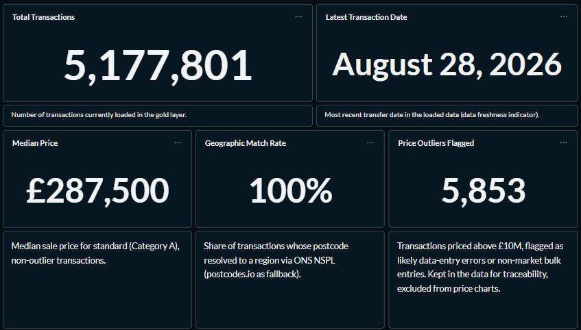
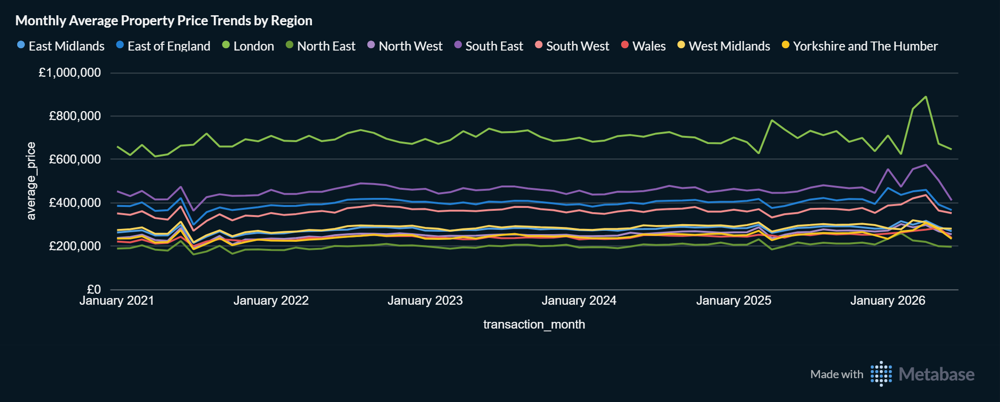
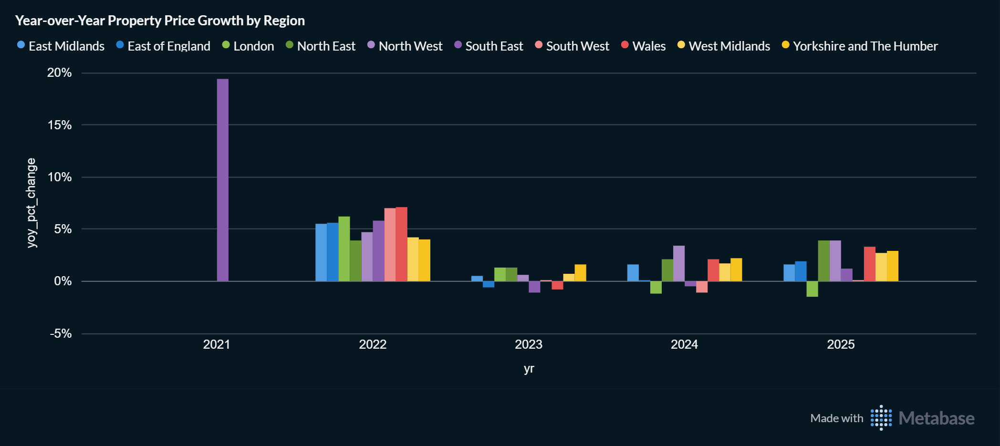
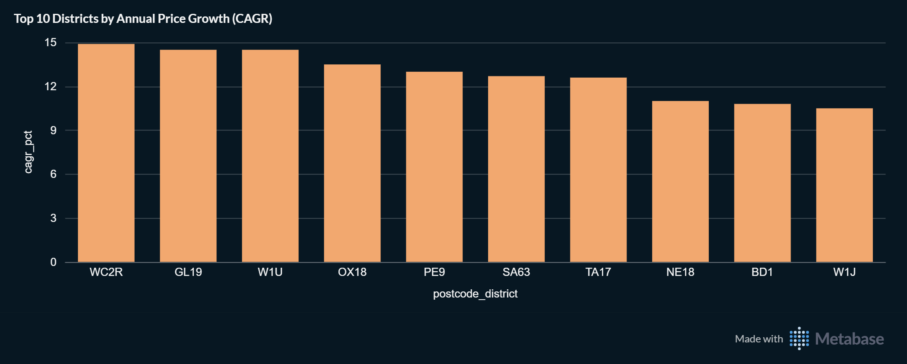
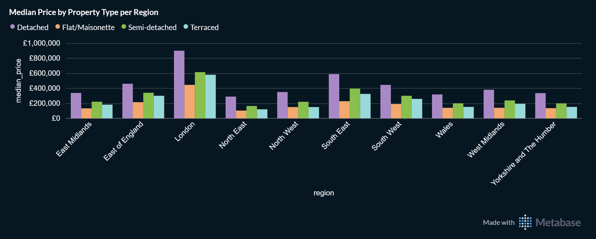
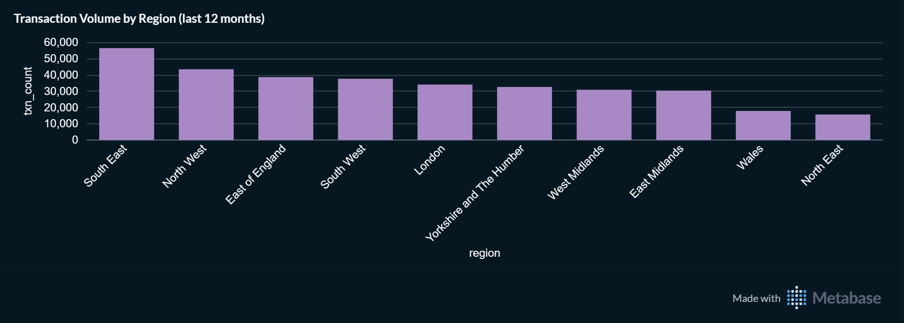
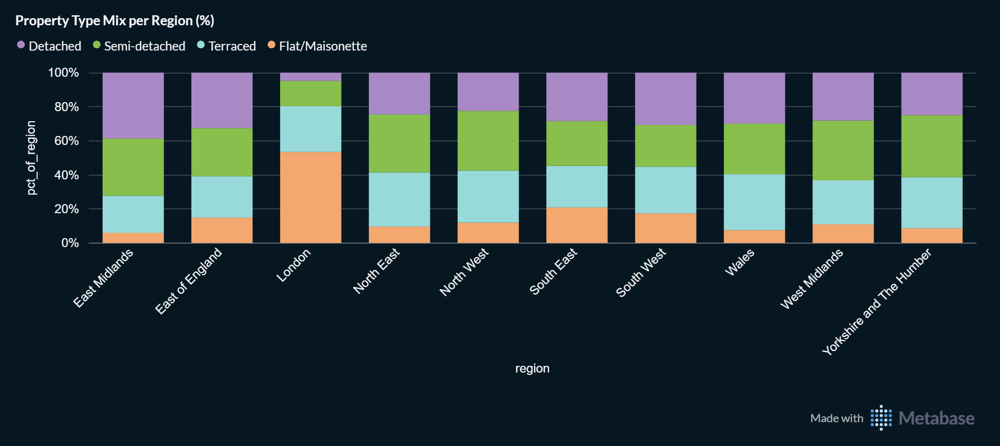

# UK Property Market Intelligence Dashboard
Built on HM Land Registry Price Paid Data, geographically enriched with ONS and postcodes.io reference data, transformed with dbt (Bronze → Silver → Gold), and orchestrated by Airflow. All figures are sourced exclusively from `gold.fct_property_prices`. Price views use standard (Category A) transactions only, with likely data-entry outliers (over £10M) excluded.

## Executive Summary & Key Findings
*(Static snapshot as of 2026-10-18. The dashboard itself refreshes as the pipeline loads new months; the figures below do not. Geographic scope is England and Wales, the jurisdiction of HM Land Registry.)*

- **Data scale and quality:** The Gold layer holds **5,177,801 transactions** (dated up to August 2026) with a **100% geographic match rate**. The national median sale price for standard (Category A), non-outlier transactions stands at **£287,500**. Extreme entries (>£10M) are flagged as potential data-entry errors or bulk sales, preserved for audit traceability, and isolated from price charts.
- **Regional price differences:** **London** has the highest prices in the dataset (detached median around £900K) and a flat-heavy housing mix (about 53% of its standard transactions). **The South East** and **North West** have the most standard transactions over the last 12 months; these are raw counts, not adjusted for housing stock or population, so they say little about relative market strength.
- **Growth districts:** Ranked by compound annual growth rate (CAGR) in average price, **WC2R** (Central London) leads at about **15% per year**, followed by **GL19** and **W1U** at roughly 14.5%. The calculation uses full calendar years only (up to 2025), within the 2021–2025 backfilled data. Three of the top ten are central London districts (WC2R, W1U, W1J), where a small number of high-value sales can move the average sharply, so the ranking is sensitive to individual property mix shifts. It measures historical appreciation within the loaded data window, not a market forecast.

## Configuration & Scope

* **Data Source:** All Metabase cards query exclusively from the Gold layer (`gold.fct_property_prices`), ensuring decoupled and business-ready analytics.
* **Dashboard Layout:** Single dashboard structured into three logical tabs:
  1. Overview and Data Quality
  2. Market Trends and Hotspots
  3. Market Segmentation
* **Formatting:** Price metrics are explicitly formatted as British Pounds (GBP, Currency style).
* **Source Scope & Data Maturity:** The pipeline ingests HM Land Registry's monthly update files (containing current-month transactions and retrospective amendments) together with a historical backfill covering 2021–2025. Transactions before 2021 (the archive runs 1995–present) are not loaded, so metrics reflect the data accumulated from 2021 onwards. The two most recent months are excluded from trend charts because registrations lag sales by up to two months.

| Convention | Applied to |
|---|---|
| Category A transactions only | Sections 2 and 3, and the Median Price card |
| Price outliers (over £10M) excluded | Sections 2 and 3 |
| Rows without a resolved region excluded | Sections 2 and 3 |
| Minimum sample size | Monthly trend: 30 per region-month. CAGR: 5 per district-year. Price by type: 10 per group |

## 1. Overview and Data Quality 


### 1.1. Total Transactions
Number of transactions currently loaded in the gold layer.

```sql
SELECT COUNT(*) AS total_transactions FROM gold.fct_property_prices;
```

### 1.2. Latest Transaction Date
Most recent transfer date in the loaded data (data freshness indicator).

```sql
SELECT MAX(transaction_date) AS latest_transaction_date FROM gold.fct_property_prices; 
```

### 1.3. Median Price (Category A, non-outlier)
Median sale price for standard (Category A), non-outlier transactions.

```sql
SELECT PERCENTILE_CONT(0.5) WITHIN GROUP (ORDER BY price) AS median_price
FROM gold.fct_property_prices
WHERE ppd_category_type = 'A' AND is_price_outlier = FALSE;
```

### 1.4. Geographic Match Rate
Share of transactions whose postcode resolved to a region via ONS NSPL (postcodes.io as fallback).

```sql
SELECT ROUND(100.0 * COUNT(*) FILTER (WHERE region IS NOT NULL) / COUNT(*), 1) AS geo_match_rate_pct
FROM gold.fct_property_prices;
```

### 1.5. Price Outliers Flagged
Transactions priced above £10M, flagged as likely data-entry errors or non-market bulk entries. Kept in the data for traceability, excluded from price charts.

```sql
SELECT COUNT(*) FILTER (WHERE is_price_outlier) AS flagged_outliers
FROM gold.fct_property_prices;
```

## 2. Market Trends & Hotspots
### 2.1. Monthly Average Property Price Trends by Region
Monthly average price by region for standard (Category A), non-outlier transactions. Only region-months with at least 30 transactions are shown, so the line may start later than the underlying data.



```sql
WITH monthly AS (
    SELECT
        transaction_month,
        region,
        AVG(price) AS average_price,
        COUNT(*) AS txn_count
    FROM gold.fct_property_prices
    WHERE ppd_category_type = 'A'
      AND is_price_outlier = FALSE
      AND region IS NOT NULL
      -- drop the most recent 2 months: still incomplete / subject to late registrations
      AND transaction_month <= DATE_TRUNC('month', (SELECT MAX(transaction_date) FROM gold.fct_property_prices)) - INTERVAL '2 months'
    GROUP BY transaction_month, region
)
SELECT transaction_month, region, average_price, txn_count
FROM monthly
WHERE txn_count >= 30  -- exclude thin months/regions prone to single-sale noise
ORDER BY transaction_month, region
```
**Visualization**: Line chart (x: transaction_month, series: region, y: average_price)

### 2.2. Year-over-year (yoy) Price Growth
Year-over-year change in average sale price by region, for full calendar years only. Each point compares a region's average price with the previous year (yoy_pct_change, %). The current, incomplete year is excluded so it doesn't distort the trend. Included: standard market sales only (PPD category A), price outliers removed, and region-years with at least 30 transactions. A year is shown only if the region also has data for the year before.



```sql
WITH yearly AS (
    SELECT
        region,
        DATE_TRUNC('year', transaction_month) AS yr,
        AVG(price) AS avg_price,
        COUNT(*) AS txn_count
    FROM gold.fct_property_prices
    WHERE ppd_category_type = 'A'
      AND is_price_outlier = FALSE
      AND region IS NOT NULL
      AND transaction_month < DATE_TRUNC('year', (SELECT MAX(transaction_date) FROM gold.fct_property_prices))
    GROUP BY region, DATE_TRUNC('year', transaction_month)
    HAVING COUNT(*) >= 30
),
with_prev AS (
    SELECT
        region, yr, avg_price, txn_count,
        LAG(yr) OVER (PARTITION BY region ORDER BY yr) AS prev_yr,
        LAG(avg_price) OVER (PARTITION BY region ORDER BY yr) AS prev_avg_price
    FROM yearly
)
SELECT
    region, yr, avg_price, txn_count,
    ROUND(((avg_price - prev_avg_price) / prev_avg_price) * 100, 1) AS yoy_pct_change
FROM with_prev
WHERE prev_yr = yr - INTERVAL '1 year'
ORDER BY region, yr
```
**Visualization**: Bar chart (x: yr, series: region, y: yoy_pct_change)


### 2.3. Top 10 Districts by Annual Price Growth (CAGR)
Postcode districts ranked by compound annual growth rate (CAGR) in average price between their first and last year with at least 5 standard (Category A, non-outlier) transactions, requiring at least two years between them so growth is comparable across districts. This reflects historical appreciation, not a forecast.



```sql
WITH district_year AS (
    SELECT
        split_part(postcode, ' ', 1) AS postcode_district,
        region,
        EXTRACT(YEAR FROM transaction_month)::int AS yr,
        AVG(price) AS avg_price,
        COUNT(*) AS txn_count
    FROM gold.fct_property_prices
    WHERE ppd_category_type = 'A'
      AND is_price_outlier = FALSE
      AND region IS NOT NULL
      AND transaction_month < DATE_TRUNC('year', (SELECT MAX(transaction_date) FROM gold.fct_property_prices))
    GROUP BY 1, 2, 3
    HAVING COUNT(*) >= 5  -- minimum sales per district-year to be meaningful
),
bounds AS (
    SELECT postcode_district, region, MIN(yr) AS first_yr, MAX(yr) AS last_yr
    FROM district_year
    GROUP BY postcode_district, region
    HAVING MAX(yr) - MIN(yr) >= 2  -- at least 2 years apart so growth can be annualized
)
SELECT
    b.postcode_district,
    b.region,
    b.first_yr,
    b.last_yr,
    d1.avg_price AS first_year_avg,
    d2.avg_price AS last_year_avg,
    ROUND((POWER(d2.avg_price / d1.avg_price, 1.0 / (b.last_yr - b.first_yr)) - 1) * 100, 1) AS cagr_pct,
    d1.txn_count AS first_year_txn_count,
    d2.txn_count AS last_year_txn_count
FROM bounds b
JOIN district_year d1
    ON d1.postcode_district = b.postcode_district AND d1.region = b.region AND d1.yr = b.first_yr
JOIN district_year d2
    ON d2.postcode_district = b.postcode_district AND d2.region = b.region AND d2.yr = b.last_yr
ORDER BY cagr_pct DESC
LIMIT 10
```
**Visualization:** Bar chart (x: postcode_district, y: cagr_pct)

## 3.	Market Segmentation 
### 3.1 Median Price by Property Type per Region
Median transaction price by property type within each region (Category A, non-outlier), shown only for groups with at least 10 transactions (N ≥ 10). 



```sql
SELECT
    region,
    CASE property_type
        WHEN 'D' THEN 'Detached'
        WHEN 'S' THEN 'Semi-detached'
        WHEN 'T' THEN 'Terraced'
        WHEN 'F' THEN 'Flat/Maisonette'
        ELSE 'Other'
    END AS property_type_label,
    PERCENTILE_CONT(0.5) WITHIN GROUP (ORDER BY price) AS median_price,
    AVG(price) AS avg_price,
    COUNT(*) AS txn_count
FROM gold.fct_property_prices
WHERE ppd_category_type = 'A'
  AND is_price_outlier = FALSE
  AND region IS NOT NULL
GROUP BY region, 2
HAVING COUNT(*) >= 10
ORDER BY region, 2
```
**Visualization:** Bar chart (x: region, series: property_type_label, y: median_price)


### 3.2	Transaction Volume by Region (last 12 months)
Number of standard (Category A, non-outlier) transactions per region over the most recent 12 months of data. This measures activity within the loaded records, not total market volume or liquidity: counts also scale with region size and are not adjusted for housing stock.



```sql
SELECT
    region,
    COUNT(*) AS txn_count
FROM gold.fct_property_prices
WHERE ppd_category_type = 'A'
  AND is_price_outlier = FALSE
  AND region IS NOT NULL
  AND transaction_date >= (SELECT MAX(transaction_date) FROM gold.fct_property_prices) - INTERVAL '12 months'
GROUP BY region
ORDER BY txn_count DESC
```
**Visualization:** Bar chart (x: region, y: txn_count) 


### 3.3	Property Type Mix per Region (%)
Share of standard transactions by property type within each region, showing structural differences such as flat-heavy versus detached-heavy markets.



```sql
WITH counts AS (
    SELECT
        region,
        CASE property_type
            WHEN 'D' THEN 'Detached'
            WHEN 'S' THEN 'Semi-detached'
            WHEN 'T' THEN 'Terraced'
            WHEN 'F' THEN 'Flat/Maisonette'
            ELSE 'Other'
        END AS property_type_label,
        COUNT(*) AS txn_count
    FROM gold.fct_property_prices
    WHERE ppd_category_type = 'A'
      AND is_price_outlier = FALSE
      AND region IS NOT NULL
    GROUP BY region, 2
)
SELECT
    region,
    property_type_label,
    txn_count,
    ROUND(100.0 * txn_count / SUM(txn_count) OVER (PARTITION BY region), 1) AS pct_of_region
FROM counts
ORDER BY region, pct_of_region DESC
```
**Visualization:** Stacked bar chart (x: region, y: pct_of_region, series: property_type_label)


## Data Attributions

- Contains HM Land Registry data © Crown copyright and database right 2021. This data is licensed under the Open Government Licence v3.0.
- Source: Office for National Statistics licensed under the Open Government Licence v.3.0. Contains OS data © Crown copyright and database right 2026. Contains Royal Mail data © Royal Mail copyright and database right 2026.

Full details, including third-party terms, are in [Data Attributions & Licences](README.md#data-attributions--licences).