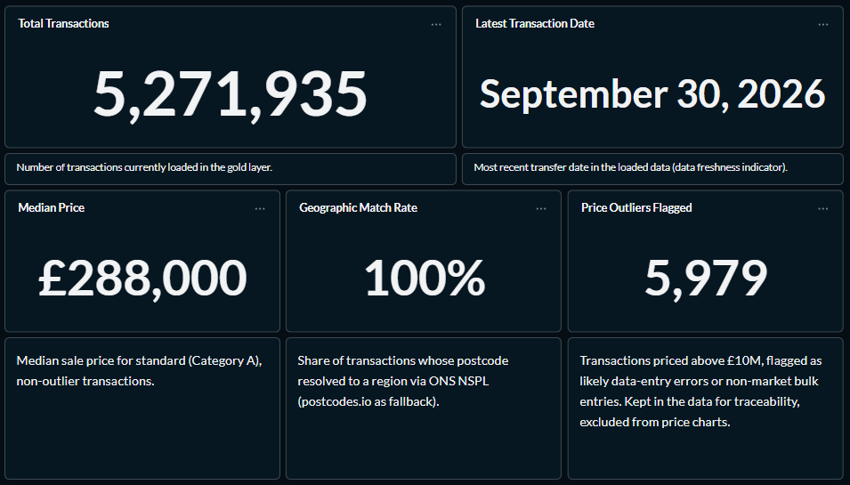
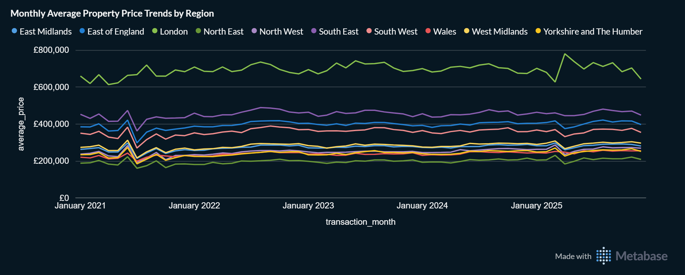
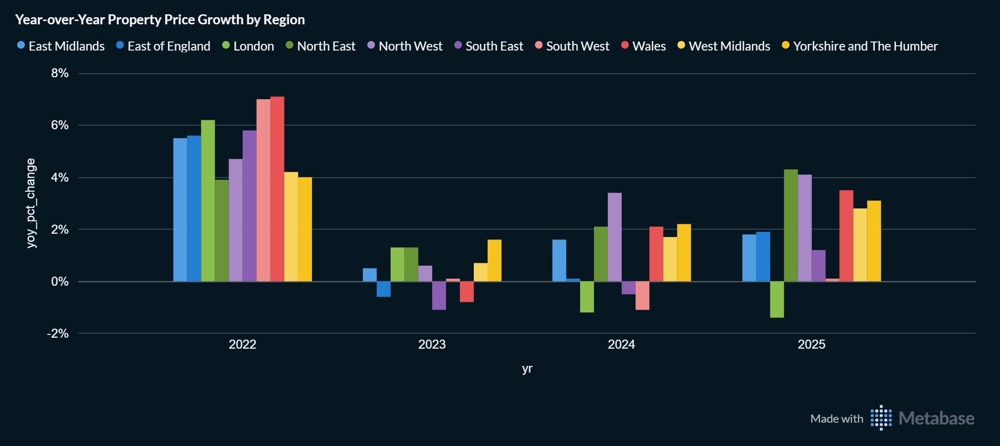
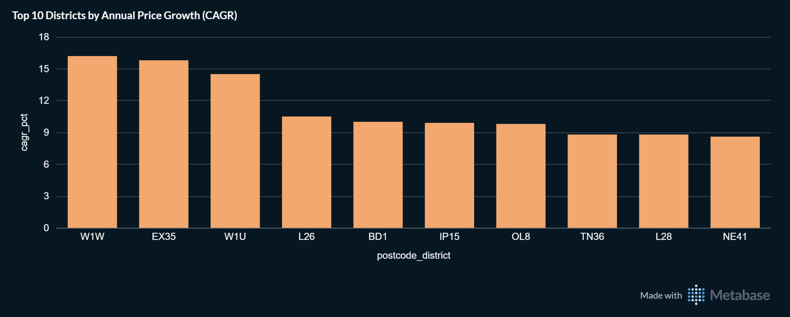
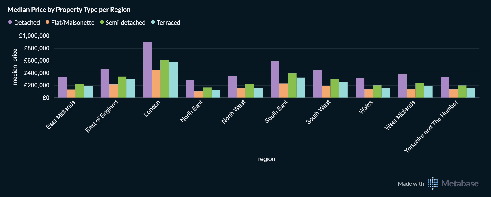
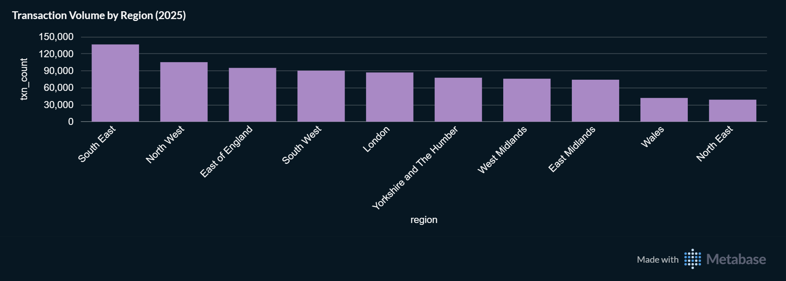
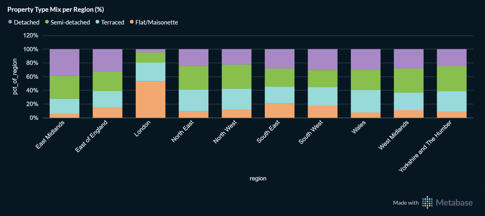

# UK Property Market Intelligence Dashboard
Built on HM Land Registry Price Paid Data, geographically enriched with ONS and postcodes.io reference data, transformed with dbt (Bronze → Silver → Gold), and orchestrated by Airflow. All figures are sourced exclusively from `gold.fct_property_prices`. Price views use standard (Category A) transactions only, with likely data-entry outliers (over £10M) excluded.

> The Metabase dashboards are live. Screenshots in this repo are dated snapshots, kept so you can see how the data changes month to month.

## Key findings (snapshot 2026-11-04)
**Data scale and quality:** The Gold layer holds 5,271,935 transactions (dated up to September 2026), 94,134 more than the previous snapshot, with a geographic match rate of 100% (rounded to one decimal). The national median sale price for standard (Category A), non-outlier transactions is £288,000. A total of 5,979 entries priced above £10M (about 0.11% of rows) are flagged as potential data-entry errors or bulk sales, preserved for audit traceability, and excluded from price charts.

**Regional price differences:** London is far above every other region (monthly average typically £650K-£750K), followed by the South East (around £450K), while the North East is lowest (around £200K). London also has the most flat-heavy mix, with about 53% of its standard transactions being flats, whereas detached homes are most prominent in the East Midlands (roughly 39% of its standard transactions). Pooled across 2021-2025 (so not current price levels), the median detached home in London is about £900K, against roughly £590K in the South East and about £290K in the North East, and flats are the lowest-priced type in most regions (about £450K in London). The South East (about 137K) and the North West (about 105K) recorded the most standard transactions in 2025; these are raw counts, not adjusted for housing stock or population, so they say little about relative market strength. Average prices moved modestly over 2021-2025 in most regions, with a simultaneous dip across regions in mid-2021 and a sharp one-month swing in London in spring 2025; the causes were not investigated.

**Growth districts:** Ranked by compound annual growth rate (CAGR) in average price within the full calendar years 2021-2025, W1W (Central London) leads at about 16% per year, followed by EX35 at about 16% and W1U (Central London) at roughly 14.5%, while the remaining seven districts in the top ten fall between roughly 8.5% and 10.5%. Each district-year in the ranking has at least 30 Category A sales, but a few high-value sales or a shift in property mix can still move the ranking, especially in smaller districts. Regional year-over-year changes in average price for 2022-2025 stay roughly between -1.5% and +7%, so district CAGRs of roughly 9-16% per year are several times higher than the regional movements and likely reflect mix shifts and individual high-value sales rather than typical market growth. The ranking measures historical appreciation within the loaded data window, not a market forecast.

Full findings and screenshots for this snapshot: [2026-11-04](doc/snapshots/2026-11-04/findings.md).

## Snapshot history

| Snapshot | Data through | Gold transactions | Median price (Cat A, non-outlier) | Geo match | Notes |
|---|---|---|---|---|---|
| [2026-11-04](doc/snapshots/2026-11-04/findings.md) | 2026-09-30 | 5,271,935 | £288,000 | 100% | After stale-row fix; first monthly UPSERT after the backfill |
| [2026-10-18](doc/snapshots/2026-10-18/findings.md) | 2026-08-28 | 5,177,801 | £287,500 | 100% | After 2021-2025 backfill; before stale-row fix |
| [2026-10-08](doc/snapshots/2026-10-08/findings.md) | 2026-08-28 | 89,133 | £300,000 | 99.9% | Pre-backfill; not comparable to later rows |

## Configuration & Scope

* **Data Source:** All Metabase cards query exclusively from the Gold layer (`gold.fct_property_prices`), ensuring decoupled and business-ready analytics.
* **Dashboard Layout:** Single dashboard structured into three logical tabs:
  1. Overview and Data Quality
  2. Market Trends and Hotspots
  3. Market Segmentation
* **Formatting:** Price metrics are explicitly formatted as British Pounds (GBP, Currency style).
* **Source Scope & Data Maturity:** The pipeline ingests HM Land Registry's monthly update files (containing current-month transactions and retrospective amendments) together with a historical backfill covering 2021–2025. Transactions before 2021 are not loaded by the backfill (a few older records can arrive through monthly amendment files); charts use an explicit 2021-2025 window. 2026 data comes only from monthly update files since the pipeline started, so it is incomplete.

| Convention | Applied to |
|---|---|
| Category A transactions only | Sections 2 and 3, and the Median Price card |
| Price outliers (over £10M) excluded | Sections 2 and 3, and the Median Price card |
| Rows without a resolved region excluded | Sections 2 and 3 |
| Minimum sample size | Monthly trend: 30 per region-month. YoY: 1,000 per region-year. CAGR: 30 per district-year. Price by type: 10 per group |
| Analysis window | 2021-2025 for sections 2 and 3 (volume chart: 2025). Overview cards (section 1) cover all loaded data, including partial 2026 |

## 1. Overview and Data Quality


### 1.1. Total Transactions
Number of transactions currently loaded in the gold layer.

```sql
SELECT COUNT(*) AS total_transactions FROM gold.fct_property_prices;
```

### 1.2. Latest Transaction Date
Most recent transfer date in the loaded data (data freshness indicator).

```sql
SELECT MAX(transaction_date) AS latest_transaction_date FROM gold.fct_property_prices;
```

### 1.3. Median Price (Category A, non-outlier)
Median sale price for standard (Category A), non-outlier transactions.

```sql
SELECT PERCENTILE_CONT(0.5) WITHIN GROUP (ORDER BY price) AS median_price
FROM gold.fct_property_prices
WHERE ppd_category_type = 'A' AND is_price_outlier = FALSE;
```

### 1.4. Geographic Match Rate
Share of transactions whose postcode resolved to a region via ONS NSPL (postcodes.io as fallback).

```sql
SELECT ROUND(100.0 * COUNT(*) FILTER (WHERE region IS NOT NULL) / COUNT(*), 1) AS geo_match_rate_pct
FROM gold.fct_property_prices;
```

### 1.5. Price Outliers Flagged
Transactions priced above £10M, flagged as likely data-entry errors or non-market bulk entries. Kept in the data for traceability, excluded from price charts.

```sql
SELECT COUNT(*) FILTER (WHERE is_price_outlier) AS flagged_outliers
FROM gold.fct_property_prices;
```

## 2. Market Trends & Hotspots
### 2.1. Monthly Average Property Price Trends by Region
Monthly average sale price by region (Category A, outliers excluded). The two most recent months are omitted because of late registrations, and region-months with fewer than 30 transactions are hidden. Data covers 2021-2025 only (2026 is incomplete).



```sql
WITH monthly AS (
    SELECT
        transaction_month,
        region,
        AVG(price) AS average_price,
        COUNT(*) AS txn_count
    FROM gold.fct_property_prices
    WHERE ppd_category_type = 'A'
      AND is_price_outlier = FALSE
      AND region IS NOT NULL
      AND transaction_month >= DATE '2021-01-01'   -- start of the backfill window
      AND transaction_month <  DATE '2026-01-01'   -- full backfilled years only
      -- drop the most recent 2 months: still incomplete / subject to late registrations
      AND transaction_month <= DATE_TRUNC('month', (SELECT MAX(transaction_date) FROM gold.fct_property_prices)) - INTERVAL '2 months'
    GROUP BY transaction_month, region
)
SELECT transaction_month, region, average_price, txn_count
FROM monthly
WHERE txn_count >= 30  -- exclude thin months/regions prone to single-sale noise
ORDER BY transaction_month, region
```
**Visualization**: Line chart (x: transaction_month, series: region, y: average_price)

### 2.2. Year-over-year (yoy) Price Growth
Year-over-year change in average sale price by region (Category A, outliers excluded). A value is shown only when both the year and the immediately preceding year have at least 1,000 transactions for that region. Covers full calendar years 2022-2025; this is not a mix-adjusted price index.



```sql
WITH yearly AS (
    SELECT
        region,
        DATE_TRUNC('year', transaction_month) AS yr,
        AVG(price) AS avg_price,
        COUNT(*) AS txn_count
    FROM gold.fct_property_prices
    WHERE ppd_category_type = 'A'
      AND is_price_outlier = FALSE
      AND region IS NOT NULL
      AND transaction_month >= DATE '2021-01-01'   -- start of the backfill window
      AND transaction_month <  DATE '2026-01-01'   -- full backfilled years only
    GROUP BY region, DATE_TRUNC('year', transaction_month)
    HAVING COUNT(*) >= 1000
),
with_prev AS (
    SELECT
        region, yr, avg_price, txn_count,
        LAG(yr) OVER (PARTITION BY region ORDER BY yr) AS prev_yr,
        LAG(avg_price) OVER (PARTITION BY region ORDER BY yr) AS prev_avg_price
    FROM yearly
)
SELECT
    region, yr, avg_price, txn_count,
    ROUND(((avg_price - prev_avg_price) / prev_avg_price) * 100, 1) AS yoy_pct_change
FROM with_prev
WHERE prev_yr = yr - INTERVAL '1 year'
ORDER BY region, yr
```
**Visualization**: Bar chart (x: yr, series: region, y: yoy_pct_change)

### 2.3. Top 10 Districts by Annual Price Growth (CAGR)
Postcode districts ranked by compound annual growth rate (CAGR) in average sale price between their first and last year with at least 30 standard (Category A, non-outlier) transactions, at least two years apart. Covers full calendar years 2021-2025. Historical appreciation, not a forecast; a few high-value sales can move averages sharply in small districts.



```sql
WITH district_year AS (
    SELECT
        split_part(postcode, ' ', 1) AS postcode_district,
        region,
        EXTRACT(YEAR FROM transaction_month)::int AS yr,
        AVG(price) AS avg_price,
        COUNT(*) AS txn_count
    FROM gold.fct_property_prices
    WHERE ppd_category_type = 'A'
      AND is_price_outlier = FALSE
      AND region IS NOT NULL
      AND transaction_month >= DATE '2021-01-01'   -- start of the backfill window
      AND transaction_month <  DATE '2026-01-01'   -- full backfilled years only
    GROUP BY 1, 2, 3
    HAVING COUNT(*) >= 30  -- minimum sales per district-year to be meaningful
),
bounds AS (
    SELECT postcode_district, region, MIN(yr) AS first_yr, MAX(yr) AS last_yr
    FROM district_year
    GROUP BY postcode_district, region
    HAVING MAX(yr) - MIN(yr) >= 2  -- at least 2 years apart so growth can be annualized
)
SELECT
    b.postcode_district,
    b.region,
    b.first_yr,
    b.last_yr,
    d1.avg_price AS first_year_avg,
    d2.avg_price AS last_year_avg,
    ROUND((POWER(d2.avg_price / d1.avg_price, 1.0 / (b.last_yr - b.first_yr)) - 1) * 100, 1) AS cagr_pct,
    d1.txn_count AS first_year_txn_count,
    d2.txn_count AS last_year_txn_count
FROM bounds b
JOIN district_year d1
    ON d1.postcode_district = b.postcode_district AND d1.region = b.region AND d1.yr = b.first_yr
JOIN district_year d2
    ON d2.postcode_district = b.postcode_district AND d2.region = b.region AND d2.yr = b.last_yr
ORDER BY cagr_pct DESC
LIMIT 10
```
**Visualization:** Bar chart (x: postcode_district, y: cagr_pct)

## 3. Market Segmentation
### 3.1 Median Price by Property Type per Region
Median sale price by property type within each region (Category A, non-outlier), pooled across 2021-2025 and shown only for groups with at least 10 transactions (N ≥ 10). Because years are pooled, values are not current price levels.



```sql
SELECT
    region,
    CASE property_type
        WHEN 'D' THEN 'Detached'
        WHEN 'S' THEN 'Semi-detached'
        WHEN 'T' THEN 'Terraced'
        WHEN 'F' THEN 'Flat/Maisonette'
        ELSE 'Other'
    END AS property_type_label,
    PERCENTILE_CONT(0.5) WITHIN GROUP (ORDER BY price) AS median_price,
    AVG(price) AS avg_price,
    COUNT(*) AS txn_count
FROM gold.fct_property_prices
WHERE ppd_category_type = 'A'
  AND is_price_outlier = FALSE
  AND region IS NOT NULL
  AND transaction_month >= DATE '2021-01-01'
  AND transaction_month <  DATE '2026-01-01'
GROUP BY region, 2
HAVING COUNT(*) >= 10
ORDER BY region, 2
```
**Visualization:** Bar chart (x: region, series: property_type_label, y: median_price)

### 3.2 Transaction Volume by Region (2025)
Number of standard (Category A, non-outlier) transactions per region in calendar year 2025. This measures activity within the loaded records, not total market volume or liquidity: counts scale with region size and are not adjusted for housing stock.



```sql
SELECT
    region,
    COUNT(*) AS txn_count
FROM gold.fct_property_prices
WHERE ppd_category_type = 'A'
  AND is_price_outlier = FALSE
  AND region IS NOT NULL
  AND transaction_month >= DATE '2025-01-01'
  AND transaction_month <  DATE '2026-01-01'
GROUP BY region
ORDER BY txn_count DESC
```
**Visualization:** Bar chart (x: region, y: txn_count)

### 3.3 Property Type Mix per Region (%)
Share of standard (Category A, non-outlier) transactions by property type within each region, 2021-2025, showing structural differences such as flat-heavy versus detached-heavy markets.



```sql
WITH counts AS (
    SELECT
        region,
        CASE property_type
            WHEN 'D' THEN 'Detached'
            WHEN 'S' THEN 'Semi-detached'
            WHEN 'T' THEN 'Terraced'
            WHEN 'F' THEN 'Flat/Maisonette'
            ELSE 'Other'
        END AS property_type_label,
        COUNT(*) AS txn_count
    FROM gold.fct_property_prices
    WHERE ppd_category_type = 'A'
      AND is_price_outlier = FALSE
      AND region IS NOT NULL
      AND transaction_month >= DATE '2021-01-01'
      AND transaction_month <  DATE '2026-01-01'
    GROUP BY region, 2
)
SELECT
    region,
    property_type_label,
    txn_count,
    ROUND(100.0 * txn_count / SUM(txn_count) OVER (PARTITION BY region), 1) AS pct_of_region
FROM counts
ORDER BY region, pct_of_region DESC
```
**Visualization:** Stacked bar chart (x: region, y: pct_of_region, series: property_type_label)

## Data Attributions

- Contains HM Land Registry data © Crown copyright and database right 2021. This data is licensed under the Open Government Licence v3.0.
- Source: Office for National Statistics licensed under the Open Government Licence v.3.0. Contains OS data © Crown copyright and database right 2026. Contains Royal Mail data © Royal Mail copyright and database right 2026.

Full details, including third-party terms, are in [Data Attributions & Licences](README.md#data-attributions--licences).