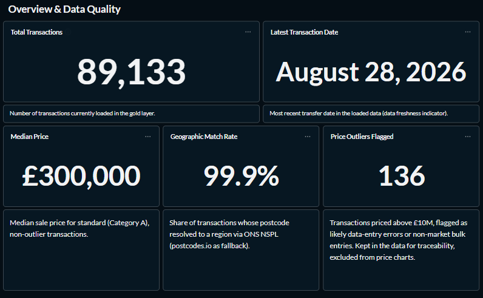
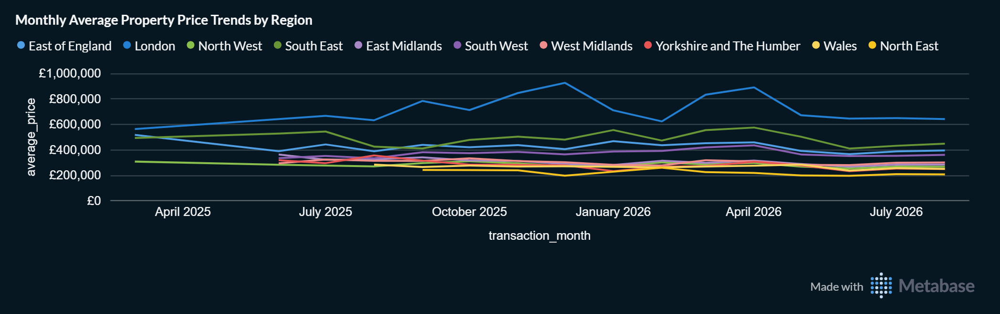
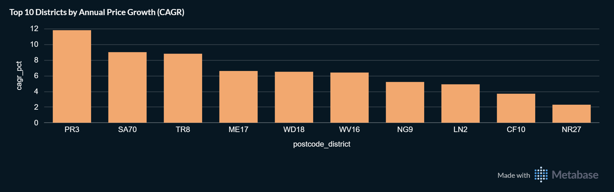
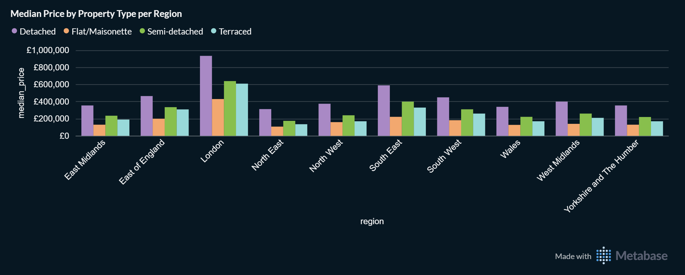
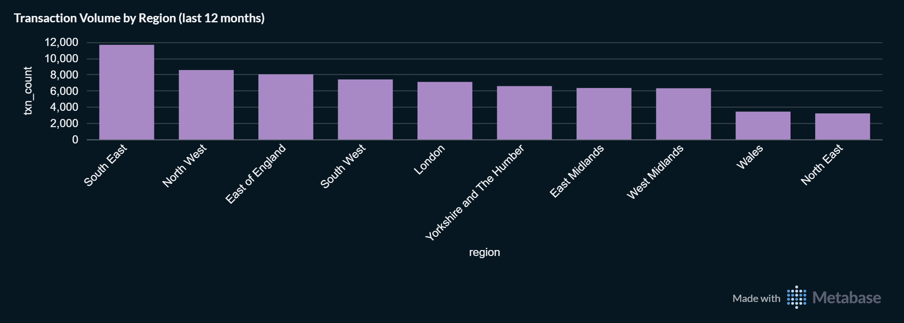
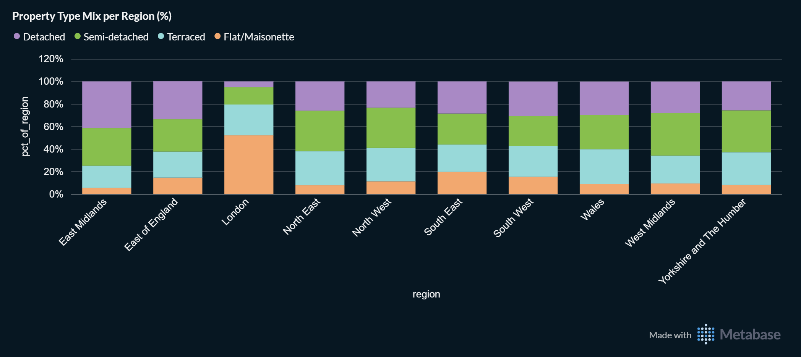
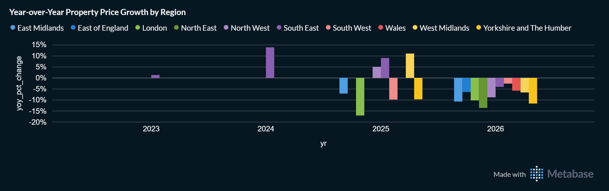

# Snapshot: 2026-10-08 (pre-backfill)

Frozen record. Do not edit except to fix typos; corrections go in the Notes section.

- Data through: 2026-08-28
- Warehouse state: first working version of the pipeline, **before** the 2021-2025 historical backfill

## Key figures

| Metric | Value |
|---|---|
| Total transactions | 89,133 |
| Latest transaction date | 2026-08-28 |
| Median sale price | £300,000 |
| Geographic match rate | 99.9% |
| Price outliers flagged (> £10M) | 136 |

## Screenshots

### Overview and data quality

### Monthly price trend

### Top 10 districts by CAGR

### Median price by property type

### Transaction volume

### Property type mix

### Year-over-year price growth (known issue)

This chart was not working correctly at the time of the snapshot: the year-over-year comparison was unreliable with the limited data loaded then. It was rebuilt after the historical backfill and is kept here only as a record of that state.

## Notes

- Taken before the 2021-2025 historical backfill, so coverage is limited to the data loaded at that time. Figures are **not comparable** to later snapshots: the lower transaction count and the higher median reflect coverage, not the market.
- Taken before the stale-row fix (v1.1.1), when Gold did not yet remove cancelled transactions automatically.