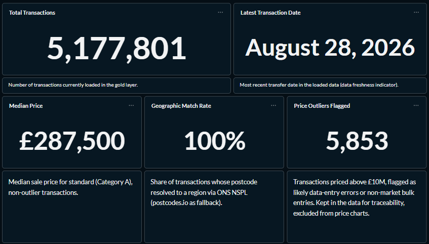
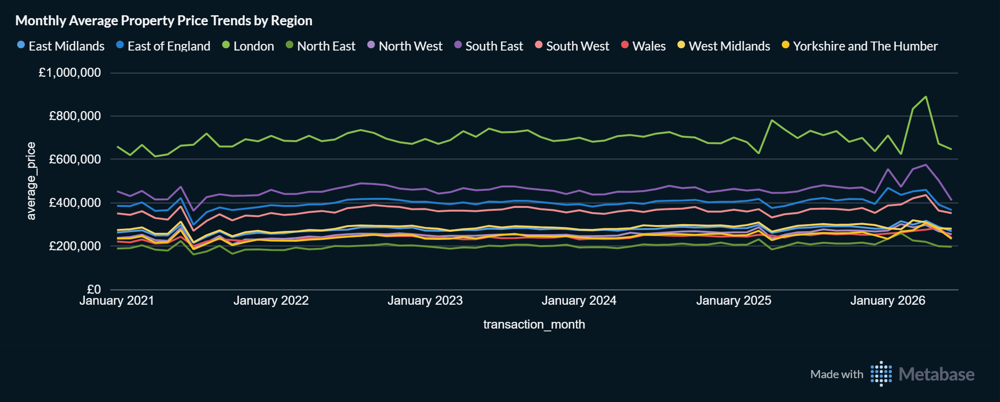
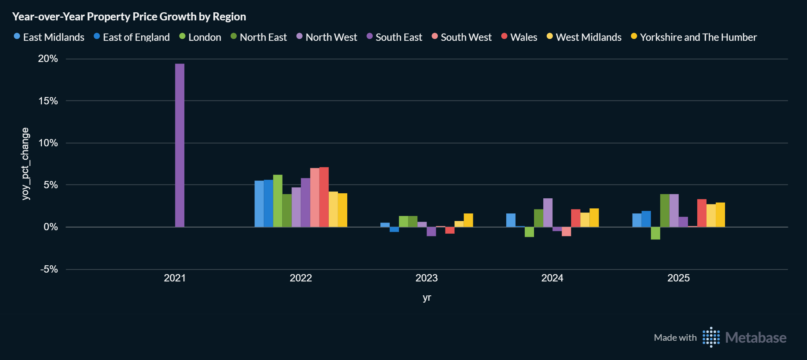
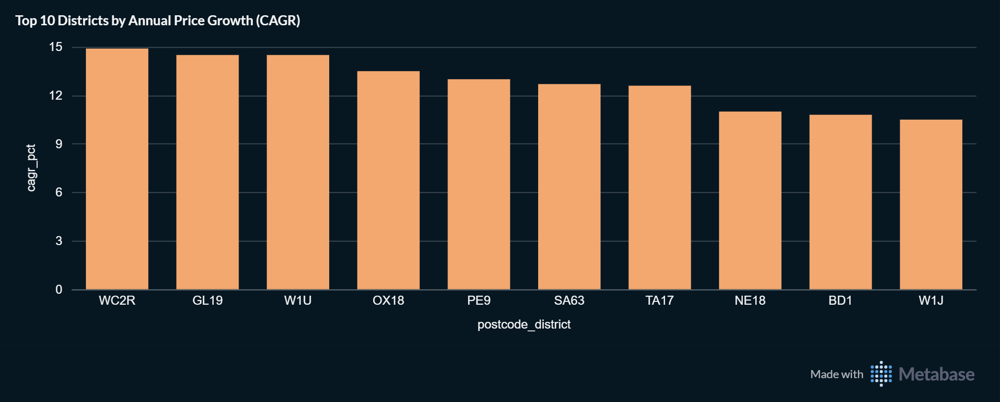
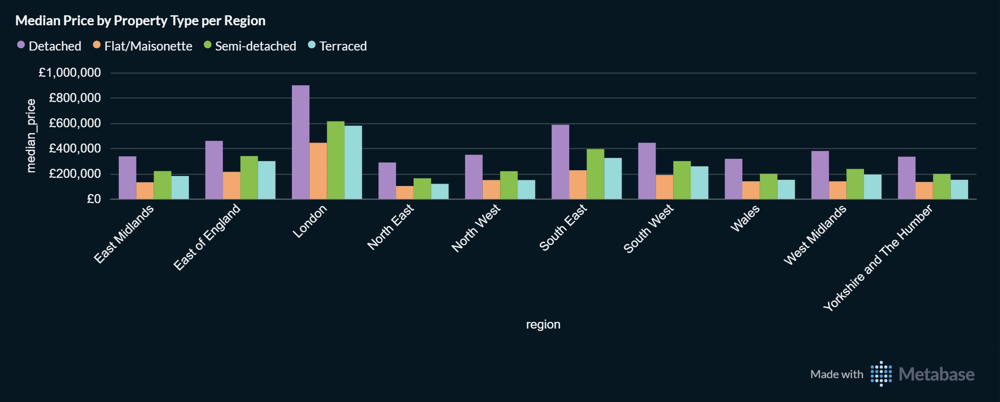
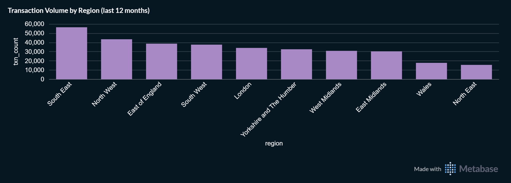
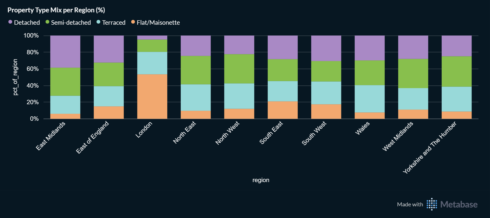

# Snapshot: 2026-10-18

Frozen record. Do not edit except to fix typos; corrections go in the Notes section.

| | |
|---|---|
| **Data through** | 2026-08-28 |
| **Gold transactions** | 5,177,801 |
| **Warehouse state** | After the 2021–2025 historical backfill (v1.1), before the stale-row fix (v1.1.1) |
| **Source** | HM Land Registry Price Paid Data, enriched with ONS NSPL and postcodes.io |

## Key findings

**Data scale and quality:** The Gold layer holds 5,177,801 transactions (dated up to August 2026) with a 100% geographic match rate. The national median sale price for standard (Category A), non-outlier transactions stands at £287,500. Extreme entries (>£10M) are flagged as potential data-entry errors or bulk sales, preserved for audit traceability, and isolated from price charts.

**Regional price differences:** London has the highest prices in the dataset (detached median around £900K) and a flat-heavy housing mix (about 53% of its standard transactions). The South East and North West have the most standard transactions over the last 12 months; these are raw counts, not adjusted for housing stock or population, so they say little about relative market strength.

**Growth districts:** Ranked by compound annual growth rate (CAGR) in average price, WC2R (Central London) leads at about 15% per year, followed by GL19 and W1U at roughly 14.5%. The calculation uses full calendar years only (up to 2025), within the 2021–2025 backfilled data. Three of the top ten are central London districts (WC2R, W1U, W1J), where a small number of high-value sales can move the average sharply, so the ranking is sensitive to individual property mix shifts. It measures historical appreciation within the loaded data window, not a market forecast.

## Dashboards

### 1. Overview and data quality

Headline KPIs: total transactions, latest transaction date, national median price, geographic match rate and flagged outliers. Median price uses standard (Category A) sales only, with outliers above £10M excluded.

### 2. Monthly Average Property Price Trends

Average price per month. Months with fewer than 30 transactions are hidden so that thin months do not create false spikes. The most recent months are incomplete because registrations can lag by up to two months.

### 3. Year-over-year price growth

Year-over-year change in average sale price. The current, partial year is excluded, and years are never bridged across gaps, so a missing year cannot produce a misleading growth figure.

### 4. Top 10 districts by CAGR

Compound annual growth rate of the average price per postcode district. A district-year needs at least 5 transactions, and the first and last year used must be at least 2 years apart. Full calendar years only.

### 5. Median price by property type

Median price for detached, semi-detached, terraced, flat and other properties, standard (Category A) sales only, outliers excluded.

### 6. Transaction volume

Standard transactions over the last 12 months by region. These are raw counts, not adjusted for housing stock or population.

### 7. Property type mix

Share of standard (Category A, non-outlier) transactions by property type within each region.

## Changes since the previous snapshot (2026-10-08)

- Data: the 2021–2025 historical backfill was loaded, so total transactions rose from 89,133 to 5,177,801. The latest transaction date is unchanged at 2026-08-28.
- The median sale price moved from £300,000 to £287,500 and the geographic match rate from 99.9% to 100%. These changes reflect much broader coverage, not market movement.
- Charts: the year-over-year chart, which was not working in the previous snapshot, was rebuilt, and the trend, CAGR and segmentation charts now cover 2021 onward.

## Notes

- **Stale rows were discovered after this snapshot.** On 2026-11-04, 965 rows (960 cancelled and 5 changed at source) were found in Gold that no longer existed in Silver, because the incremental model only inserts and updates rows. This snapshot reflects the data as loaded at the time; the effect on the medians and rankings is expected to be negligible (about 0.02% of Gold). From v1.1.1 onward Gold is kept equal to Silver automatically.
- **Rows without a postcode** (about 0.3% of the raw data) are excluded from Silver and therefore from every figure above.
- **Recent months are incomplete.** Land Registry registrations can lag by up to two months, so the latest months will change in later snapshots.
- **The year-over-year chart** in this snapshot also shows 2021, which is compared against a very thin 2020 sample. The query was corrected in the 2026-11-04 snapshot: it now covers full calendar years 2022-2025 only, with a minimum of 1,000 transactions per region-year.
- **The transaction volume chart** used a rolling 12-month window, which likely included months of 2026 with incomplete coverage, so absolute counts are probably understated. The 2026-11-04 snapshot uses calendar year 2025 instead.
- **The CAGR query** in this snapshot had no explicit lower bound on the start year, so the statement that it uses data within 2021-2025 was not verified for every district.
- **Chart queries** were tightened in the 2026-11-04 snapshot (explicit 2021-2025 window; year-over-year requires 1,000 transactions per region-year; CAGR requires 30 transactions per district-year instead of 5). Differences from this snapshot may come from the method, not only from new data.