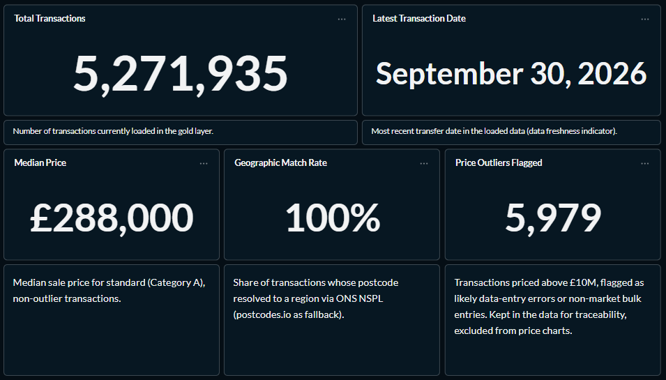
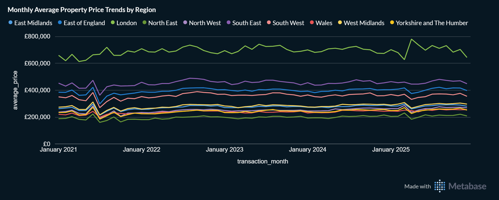
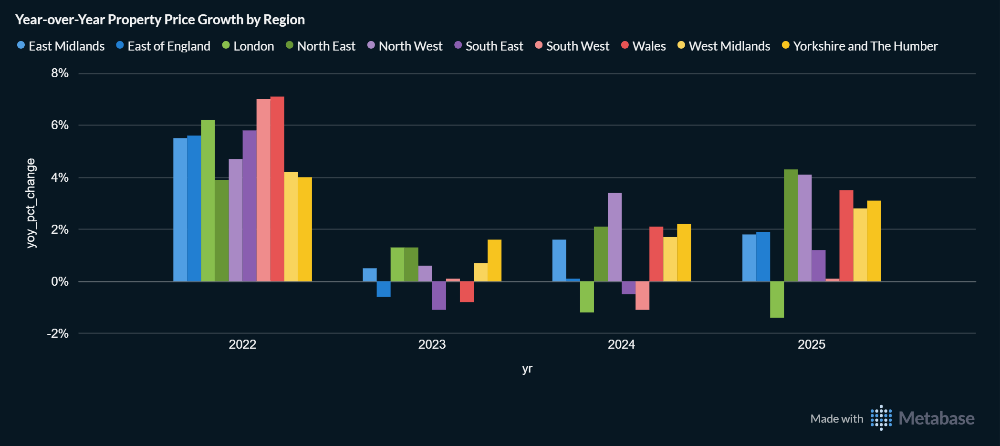
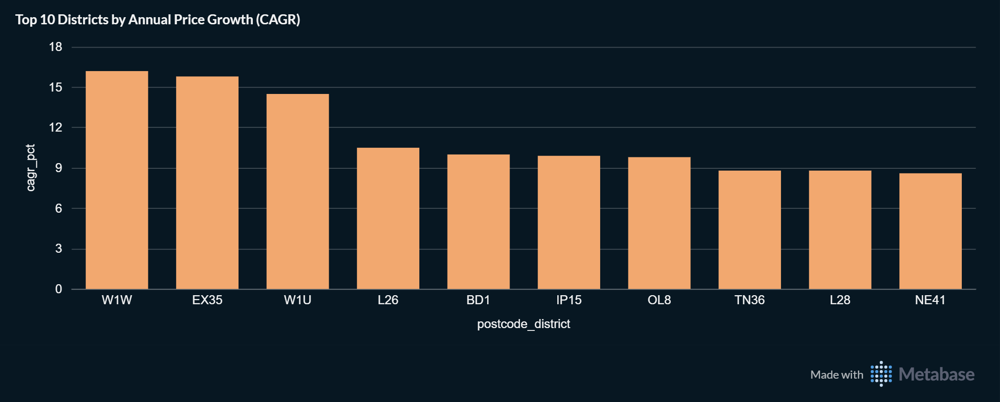
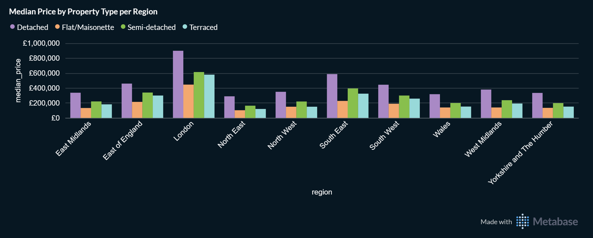
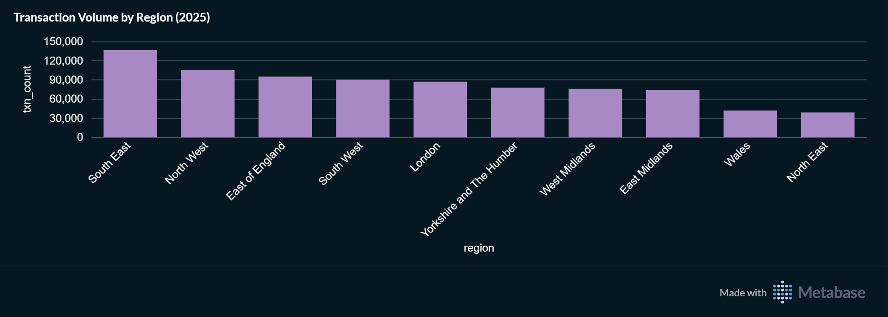
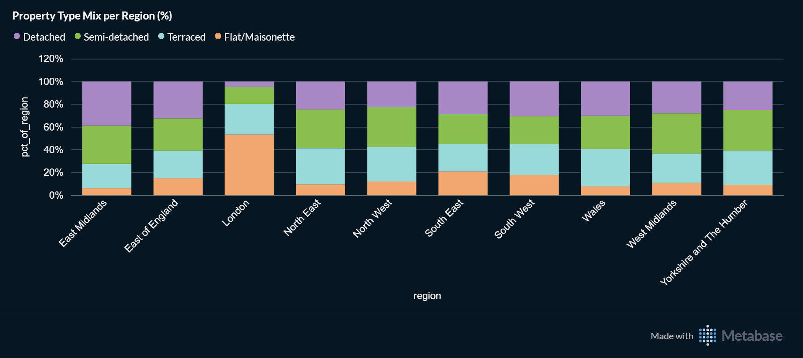

# Snapshot: 2026-11-04

Frozen record. Do not edit except to fix typos; corrections go in the Notes section.

- Data through: 2026-09-30
- Warehouse state: first monthly update after the 2021-2025 historical backfill, with the stale-row fix applied (gold matches silver)

## Key figures

| Metric | Value |
|---|---|
| Total transactions | 5,271,935 |
| Latest transaction date | 2026-09-30 |
| Median sale price (Category A, non-outlier, all loaded data) | £288,000 |
| Geographic match rate | 100% (rounded to one decimal) |
| Price outliers flagged (> £10M) | 5,979 |

## Key findings

**Data scale and quality:** The Gold layer holds 5,271,935 transactions (dated up to September 2026), 94,134 more than the previous snapshot, with a geographic match rate of 100% (rounded to one decimal). The national median sale price for standard (Category A), non-outlier transactions is £288,000. A total of 5,979 entries priced above £10M (about 0.11% of rows) are flagged as potential data-entry errors or bulk sales, preserved for audit traceability, and excluded from price charts.

**Regional price differences:** London is far above every other region (monthly average typically £650K-£750K), followed by the South East (around £450K), while the North East is lowest (around £200K). London also has the most flat-heavy mix, with about 53% of its standard transactions being flats, whereas detached homes are most prominent in the East Midlands (roughly 39% of its standard transactions). Pooled across 2021-2025 (so not current price levels), the median detached home in London is about £900K, against roughly £590K in the South East and about £290K in the North East, and flats are the lowest-priced type in most regions (about £450K in London). The South East (about 137K) and the North West (about 105K) recorded the most standard transactions in 2025; these are raw counts, not adjusted for housing stock or population, so they say little about relative market strength. Average prices moved modestly over 2021-2025 in most regions, with a simultaneous dip across regions in mid-2021 and a sharp one-month swing in London in spring 2025; the causes were not investigated.

**Growth districts:** Ranked by compound annual growth rate (CAGR) in average price within the full calendar years 2021-2025, W1W (Central London) leads at about 16% per year, followed by EX35 at about 16% and W1U (Central London) at roughly 14.5%, while the remaining seven districts in the top ten fall between roughly 8.5% and 10.5%. Each district-year in the ranking has at least 30 Category A sales, but a few high-value sales or a shift in property mix can still move the ranking, especially in smaller districts. Regional year-over-year changes in average price for 2022-2025 stay roughly between -1.5% and +7%, so district CAGRs of roughly 9-16% per year are several times higher than the regional movements and likely reflect mix shifts and individual high-value sales rather than typical market growth. The ranking measures historical appreciation within the loaded data window, not a market forecast.

## Screenshots

### Overview and data quality

### Monthly average price trend

### Year-over-year price growth

### Top 10 districts by CAGR

### Median price by property type

### Transaction volume by region (2025)

### Property type mix

## Changes since the previous snapshot (2026-10-18)

- **Data:** first monthly update after the backfill; the latest transaction date moved from 2026-08-28 to 2026-09-30, and total transactions rose by 94,134 (from 5,177,801 to 5,271,935). The median moved from £287,500 to £288,000.
- **Warehouse:** cancelled transactions are now removed from gold automatically, so gold equals silver. 965 rows (960 cancelled and 5 changed at source) that no longer existed in silver were removed, so the net change of +94,134 transactions is after that removal.
- **Method:** charts now use an explicit 2021-2025 window. Year-over-year growth covers 2022-2025 with at least 1,000 transactions per region-year, and the CAGR ranking only considers 2021-2025 and requires at least 30 transactions per district-year (previously 5), so it differs from the previous snapshot because of the query, not because of new data. The volume chart now shows calendar year 2025 instead of a rolling 12 months, so it is not directly comparable with the previous snapshot.

## Notes

- 2026 data is partial: it comes only from the monthly update files since the pipeline started running, so 2026 is excluded from year-based comparisons.
- Transactions without a postcode (about 14,600 rows) are excluded from the silver layer and therefore from all charts.